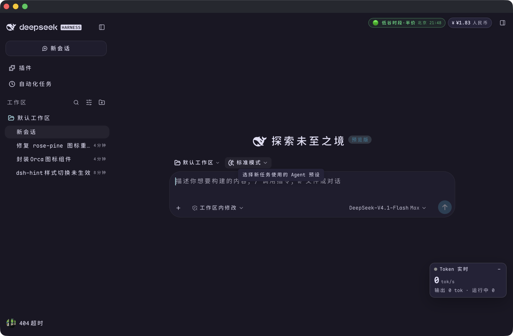
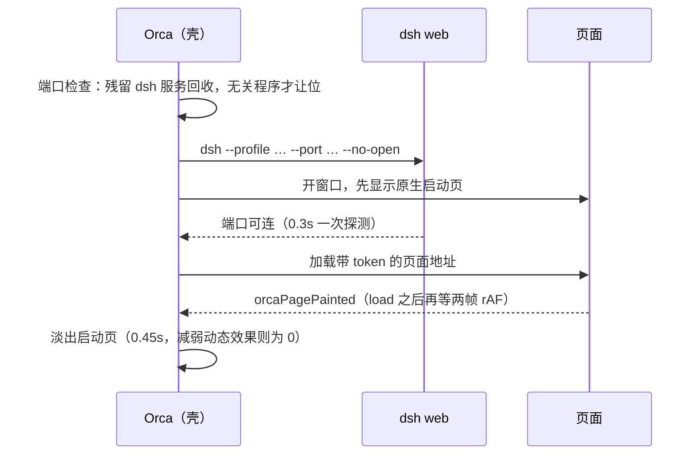

# Orca

DeepSeek Harness 的 Web UI，原生 macOS 外壳：Swift + AppKit + WKWebView，不带 Electron。

双击即用——应用自己拉起本地 `dsh web`，把界面装进原生窗口，并让窗口按桌面端该有的样子存在：
红绿灯、52px 标题条、系统菜单、可录制的桌面快捷键。



## 构建

要求 macOS 13+、Xcode Command Line Tools（`swiftc`）。

```sh
./build.sh               # 编译 → 组装 → ad-hoc 签名 → 安装到 /Applications/Orca.app
./build.sh --no-install  # 只产出 build/Orca.app
```

在沙箱里编译（`swift build` 的 manifest 会起 `sandbox-exec`）需要关掉它：

```sh
ORCA_SWIFT_FLAGS=--disable-sandbox ./build.sh
```

两个可覆盖的开关：`ORCA_INSTALL_DIR`（默认 `/Applications`）、`ORCA_SIGN_IDENTITY`（默认 `-`，即 ad-hoc）。

重建后重启：

```sh
osascript -e 'quit app "Orca"'; open -a /Applications/Orca.app
```

`build.sh` 在两个地方多做了事，都是为了避免重建把用户可见状态弄丢：

- **图标**：运行中的应用会把选定的图标写进已安装 bundle 的 `AppIcon.icns`，而重建会用仓库里的默认图覆盖它。
  所以脚本先比较「已安装的」和「仓库的」，不同就沿用已安装的那个。
- **签名**：ad-hoc 的默认 designated requirement 是 cdhash，每编译一次系统就当成了一个全新应用，
  TCC 授权（文稿目录等）会重新问一遍。所以显式给一条稳定的 `identifier "com.xu.orca"`。

## 安装包

`package.sh` 从 `Resources/Info.plist` 取版本号，产出两个等价的分发件到 `dist/`：

| 产物 | 用法 |
| --- | --- |
| `Orca-<版本>.pkg` | 双击安装，`installer` 直接写 `/Applications`，声明了最低系统版本 |
| `Orca-<版本>.dmg` | 打开后把 Orca 拖进 Applications，盘内附 `READ ME.txt`（含首次打开的放行步骤） |
| `SHA256SUMS.txt` | 上面两个件的校验和 |

```sh
./package.sh            # 两个都出
./package.sh --no-pkg   # 只要 dmg
./package.sh --no-dmg   # 只要 pkg
```

版本号只写在 `Resources/Info.plist` 一处（`CFBundleShortVersionString` / `CFBundleVersion`），
打包与产物命名都从那里取，不要另建一处。

两个件都是 **ad-hoc 签名**（本机没有 Developer ID 证书，`security find-identity` 为 0 个身份），
所以拷到别的机器上首次打开会被 Gatekeeper 拦一次：右键「打开」，或到
「系统设置 → 隐私与安全性 → 仍要打开」。要彻底免掉这一步：

```sh
ORCA_SIGN_IDENTITY="Developer ID Application: …" \
ORCA_INSTALLER_IDENTITY="Developer ID Installer: …" ./package.sh
```

二进制目前是 **arm64 only**——`swift build --arch arm64 --arch x86_64` 需要完整 Xcode
（本机只装了 CommandLineTools，多架构构建会报 `xcbuild … does not exist`）。要出通用包得先装 Xcode。

## 启动与交接



- **默认端口 4319**。端口固定意味着页面 origin（`http://127.0.0.1:<port>`）固定，localStorage 里的界面状态才能跨启动留下。
  被占用时先分辨占用者：是上次残留的 `dsh web` 就请它退出（SIGTERM，不退则 SIGKILL）后仍用 4319；
  只有被无关程序占用才改用系统分配的空闲端口——杀别人的进程不是 Orca 该做的事。
- **启动页**：透明磨砂玻璃底，图标是**透明底的角色标**（`Resources/Icons/OrcaMark.png`，84pt 槽位），
  按 app 图标同一套连续曲率 squircle 裁形（`IconProcessor.rounded`），所以轮廓和 Dock 里那个是同一个形状。
  它没有自己的背景色，永远落在主题底色上——换主题不会出现「图标和背景两个颜色」。文字、按钮和磨砂材质
  也跟着**底色本身的明暗**走，而不是系统外观：系统暗色 + 浅色主题时，启动页仍是浅底深字。
  启动阶段宿主可能先上报一帧系统方案的底色；**页面首帧之前只接受与已保存主题来源（没有来源时用上次底色）
  一致的底色**，瞬时深色不会刷到启动页，也不会被记成下次启动的底色。
- **交接时机不看秒数**：启动页撤除等的是页面自己的首帧事件，不是「服务就绪 + 等 N 秒」。
  web view 自身不画背景、容器铺的是主题 base，所以淡出过程中任何缝隙看到的都是页面自己的颜色，不是默认窗口灰。
- **兜底**：页面加载失败（`didFail*`）立即撤；12 秒仍未报首帧（脚本被拦等极端情况）也强行撤，避免启动页焊死。
  启动失败时显示原因，并提供「Try Again / Service Log」。
- **重启服务**（⇧⌘R、改设置或启动页按钮）走同一张启动页，只有进度条没有按钮。

## 服务与端口

上次运行异常退出留下的服务进程会被下一次启动复用——不重新拉起，端口与登录 cookie 都不变。

复用的服务没有子进程可监听（`waitUntilExit` 只对亲生的有效），所以壳自己盯着它：每 2 秒查一次进程与端口，
连续 3 次失联判定死亡 → 自动重启一次（新 token，页面按新地址重载，连接自己恢复），再死就回启动页给「Try Again」。
这是「页面一直转圈重连、窗口却什么都不知道」那个状态的根因修复。

也因此有个副作用值得知道：**改了端口偏好不会立刻生效**——只要旧服务还活着就会被复用，
要等在设置里重启服务、或旧服务退出之后，才换到新端口。

## 窗口与标题栏

红绿灯默认**常显**，没有可见标题栏：页面以桌面壳布局自带顶部标题条，三颗灯浮在其上、与图标行同一水平线
（AppKit 把灯居中在 28pt 标题栏里，所以原生灯位下移 9pt 对齐）。

`dsh-orca-titlebar` 插件通过 `orcaTitleBar` 桥切档位：

| 档位 | 表现 |
| --- | --- |
| `lightsOnly`（默认） | 真灯常显，页面全幅 |
| `hover` | 隐藏，指针进入窗口顶部 28pt 才淡入真灯 |
| `hidden` | 完全隐藏，最大化可用面积 |
| `shown` | 回到标准 `.titled` 窗口 |

拖拽：页面 header 仍是拖拽区（高度按页面 header 实测上报，兜底 40px），点按先交给网页，按钮不受影响。

关闭窗口（⌘W）不退出应用，点 Dock 图标回来；⌘Q 退出并停止服务（设置里开了「退出后保留服务」则例外）。

## 快捷键

| 操作 | 快捷键 |
| --- | --- |
| 刷新页面 | ⌘R |
| 从服务器重新加载 | ⌥⌘R |
| 实际大小 / 放大 / 缩小 | ⌘0 / ⌘+ / ⌘- |
| 全屏 | ⌃⌘F |
| 拖动窗口 | 按住页面顶部 header 拖动 |
| 关闭窗口（应用保留） | ⌘W |
| 最小化 | ⌘M |
| 重启本地服务 | ⇧⌘R |
| 在浏览器打开（带 token 的地址） | ⇧⌘O |
| 开发者工具（WebKit Web Inspector） | F12 或 ⌥⌘I |
| 元素拾取（在页面上点一个元素，再按一次退出） | ⌘⇧C |
| Orca 设置（端口 / Profile / 命令） | ⌥⌘, |
| 退出 | ⌘Q |

`File → Copy Access Link` 可复制带 token 的访问地址。

⌘, **不由 Orca 占用**：它交给页面，由 DSH 自己的设置页处理；壳自己的面板挪到 ⌥⌘,。

### 桌面快捷键

页面以 `<html data-platform="darwin">` 启动，DSH 的快捷键服务按桌面运行时工作：设置页可以录制任意组合
（包括 ⌘C、⌘K 这类网页模式会拒绝的键）。`window.dshDesktop` 只在 shortcuts 服务构造期间可见，
服务捕获 keyboard 与 keybindings 适配器后立即撤下，所以账户、登录、引导、聊天等插件仍走 Web 路径。

- 键位覆盖存在 `~/Library/Application Support/Orca/keybindings.json`，格式与 DSH 桌面端一致（revisioned JSON，原子写入）。
- keyboard 桥按当前 revision 转发 `keydown`，支持双键 chord；录制期间暂停转发。
- 原生菜单仍会先截获 ⌘R、⌘W、⌘Q 等组合；这些键在 DSH 里可以录，但按下时由 Orca 菜单处理。⌘, 不在其中。
- 侧栏顶部用 DSH 桌面布局的 52px 标题条，`lightsOnly` 不再额外加原生 44px inset，避免双倍留白。
- 桌面账户/登录页（`dshPlatform`）没有实现，账户插件保持 Web 登录；`deviceInfo` 桥已就绪但当前无消费者。

系统级热键由 `GlobalHotkeyCenter`（Carbon）提供：功能侧调用 `register(_:binding:handler:)` 才占用按键，
`handler` 可先留空；`whileActive` 作用域只在 Orca 前台时占用，失焦即释放。默认没有全局绑定。

### Electron 默认菜单对照

Electron 默认菜单的键位对照整理在 `ElectronDefaults`（`ElectronShortcuts.swift`）。这张表现在**没有消费者**——
Orca 自己的菜单与响应链已经覆盖它列出的每一个组合——所以整段注释保留、不删：它记录的是「哪个 Electron 组合
对应哪个 Orca 动作、哪两处不一致」这个判断。要恢复它，得连同当时消费 `coverage` 的 while-active 占位逻辑一起接回。

结论不变，仍是这张表想说明的事：已有的动作不重复注册，缺口交给 DSH 桌面快捷键录制，不装空 Carbon 占位。

| 状态 | 条目 |
| --- | --- |
| 已对齐 | ⌘H、⌥⌘H、⌘Q、⌘W、⌘Z、⇧⌘Z、⌘X、⌘C、⌘V、⌘A、⌘R、F12（Developer Tools）、⌘0、⌘+、⌘-、⌃⌘F、⌘M |
| 缺口 | Paste and Match Style ⌥⇧⌘V：DSH 桌面快捷键可录制；Orca 不抢键 |
| 冲突 | Force Reload ⇧⌘R：⇧⌘R 已是「重启本地服务」，Orca 的强制重载是 ⌥⌘R |
| 无快捷键缺口 | Delete、Substitutions 子菜单、Speech 子菜单、Help 的 Learn More / Documentation / Search Issues |

## 开发者工具

F12（或 ⌥⌘I）开关 **WebKit 自带的 Web Inspector**——就是 Safari「开发」菜单里那一个：Elements、Console、
Sources、Network、Timelines、Storage、Graphics、Layers 全都在，dock 在窗口内，跟着窗口一起缩放。
关掉再开，面板、选中的元素、控制台历史都还在原处。

| 操作 | 快捷键 | 说明 |
| --- | --- | --- |
| 打开 / 关闭检查器 | F12、⌥⌘I | 与浏览器同义 |
| 元素拾取 | ⌘⇧C | 打开检查器并进入拾取模式：页面里悬停即高亮，点击就选中那个元素；拾取中再按一次停止，页面恢复普通点击 |
| 只看控制台 | View → Show Console | 直接落到 Console 页签 |
| 右键「检查元素」 | 右键菜单 | WebKit 提供的菜单项（靠开发者附加项，见下） |

**它要求 `get-task-allow`**：WebKit 只为「可调试」的进程构建 inspector 前端。没有这个 entitlement，
`show` 是一次**静默的空操作**——没有任何窗口、没有任何报错。我第一轮得出「macOS 26 上不可用」的结论就是
因为这个：当时的测试 app 没带权限，于是把「权限不够」误判成了「平台不支持」。实际加上之后，
`visible` 立刻变成 1，`inspectorWebView` 拿到 `inspector-resource:///Main.html`，整套界面都在。

所以 `build.sh` 现在统一用 `Resources/Orca.entitlements` 签名（`package.sh` 调用同一个脚本，DMG/PKG
也带着它）。同时 `WKPreferences._developerExtrasEnabled` 被打开——**光设 `isInspectable` 不够**，
它只负责把页面暴露给 Safari，不会在应用内构出检查器，右键菜单也不会出现「检查元素」。

打开失败时不会静默：3 秒后若前端仍未构建（`inspectorWebView` 不存在），会弹一条 sheet 说明缺了哪个
entitlement、怎么重建。判据只能看前端在不在——冷启动时前端本身要 0.5–1 秒才可见，用 `isVisible`
会把「正在加载」误报成「没打开」，而那条 sheet 恰好盖住刚打开的检查器。关闭检查器会取消这次校验。

> 早期版本里这套工具是自研的（注入 agent + 原生 dock + 面板前端，四个页签）。既然原生 inspector 完整可用，
> 就没必要维护一份更弱的复制品，自研实现留在 git 历史里（`1f1a012` 及之前），需要时可以取回。

## 设置

两套设置各管一块，互不抢键：

- **页面里的 DSH 设置页**（⌘,）：主题、插件、账户、快捷键，以及图标行——页面自己能看见的东西。
- **Orca 自己的面板**（⌥⌘,）：壳才有的东西。

| 项 | 默认 | 说明 |
| --- | --- | --- |
| Port | `4319` | `0` 表示自动挑空闲端口 |
| Profile | `web` | `dsh` 启动的 profile |
| dsh command | `dsh` | PATH 名或绝对路径；GUI 进程继承 launchd 的最小 PATH，应用会自动在 `~/.npm-global/bin`、`~/.local/bin`、`/opt/homebrew/bin`、`/usr/local/bin` 等目录查找 |
| Keep the local service running after Orca quits | 关 | 退出后保留服务，下次启动直接复用 |

改端口 / Profile / 命令会重启服务。各插件写在磁盘上的服务端配置不受影响；页面 origin 下的 localStorage
（主题、界面状态等）**目前会从新的空存储开始**——迁移链路只接好了写入端：`WebPageStorage` 的写回脚本与
`WebPageController.stageStorage(for:)` 都在，但负责抓快照的 `captureLocalStorage()` 没有调用者，
`pendingStorage` 恒为 nil。接上它要动 `load(_:)` 的时机（抓取是异步的），属于行为改动。

## 图标

设置页的图标行给出六个预设，走 `orcaAppIcon` 桥；壳负责合成与落盘（`AppIcon` → `IconProcessor` → `AppIconInstaller`）：

| 预设 | 来源 |
| --- | --- |
| `orca` | 初始图标，固定；跟随控件禁用 |
| `dawn` / `main` / `moon` | 三套主题变体，可切换 不跟随 / 随主题 / 随系统 |
| `template` | `OrcaOutline.svg` 模板 + 自选底色，可切换 不跟随（自选色）/ 随主题（页面底色）/ 随系统（`#faf4ed` / `#191724`） |
| `custom` | 用户自选的图片（png/jpg/heic/tiff/gif/webp 都收），固定；跟随控件禁用 |

所有内置素材都是满幅画稿，一律经 `IconProcessor` 合成到 Apple 的图标网格（1024 画布 / 824 主体 / 内缩 100），
裁成连续曲率 squircle——满幅方块贴上去会比系统图标明显偏大、而且是直角。`IcnsWriter` 直接写 PNG-backed 的
`.icns` 条目，不起 `iconutil`、不落临时 `.iconset`。

选定结果会写进已安装 bundle 的 `AppIcon.icns`（Finder 与下次启动读的就是它），并刷新运行中的 Dock tile；
`build.sh` 重建时会沿用这份，而不是退回仓库默认图。

写 bundle 有两件连带的事，都在 `AppIconInstaller` 里：

- `AppIcon.icns` 是被签名的资源，写完必须**重新 ad-hoc 签名**（`AppBundleSeal`，0.9s 合并一次、后台串行、
  退出前 flush），否则 `codesign --verify` 会报 `file modified`。签名沿用 `identifier "com.xu.orca"` 与
  `--preserve-metadata=entitlements`，TCC 授权才不会被重新询问。
- IconServices 以 **bundle 自身的修改时间**为图标缓存令牌，不看 `Contents/Resources/AppIcon.icns`，所以
  写完还要把 bundle 的时间戳推到图标之后（`markBundleChanged`）。只在图标比 bundle 新时才推，稳态启动
  不会每次重建索引。

图标的跟随是三态，**同一时刻只有一个来源参与取色**：

| 模式 | 颜色来源 | 触发重写 |
| --- | --- | --- |
| 不跟随 | 图标选择本身（模板用自选底色，主题预设用固定素材） | 只在改图标设置时 |
| 随主题 | 页面主题：模板取页面 base，主题预设取页面变体 | 页面主题切换时 |
| 随系统 | macOS 外观：浅色 `#faf4ed` / 深色 `#191724`，主题预设浅色 Dawn、深色用所选深色 | 系统切亮暗时 |

「不跟随」和「随系统」都不受页面主题影响，手动切浅色不会改图标；「随主题」才让页面底色/变体参与。
Orca 完全退出后系统再切外观（随系统模式），静态图标无法自行更新，要等下次启动。

## 数据与日志

| 路径 | 内容 |
| --- | --- |
| `~/Library/Logs/Orca/service.log` | `dsh web` 的 stdout/stderr，含访问 URL 与 token（分享前注意脱敏） |
| `~/Library/Logs/Orca/web.log` | 页面 `console.error` 与未捕获异常 |
| `~/Library/Application Support/Orca/session.json` | 服务 pid + 访问 URL（权限 0600） |
| `~/Library/Application Support/Orca/keybindings.json` | DSH 桌面快捷键覆盖 |

## 代码结构

```text
Sources/Orca/
  入口
    main.swift                    应用入口
    AppDelegate.swift             生命周期、Help、设置入口

  窗口与界面
    MainWindowController.swift    窗口、启动页状态与交接、主题同步、菜单动作
    WindowChrome.swift            标题栏档位、红绿灯显隐与 hover 带
    SplashView.swift              原生启动 / 故障页（磨砂底 + 主题基色）
    DraggableWebView.swift        顶部拖拽区 → 原生窗口拖动
    SettingsWindowController.swift  服务参数面板（⌥⌘,）
    MainMenu.swift                菜单栏
    Layout.swift                  铺满父视图的约束助手
    ColorHex.swift                #rrggbb ↔ NSColor、亮度判断
    ThemeColor.swift              首帧之前铺的底色（含首次启动兜底）
    ProfileFont.swift             从 profile 的 cordis.patch.yml 读文本字体栈（启动页对齐页面）

  Web 页面
    WebPageController.swift       WKWebView 本体、注入、缩放、全屏镜像
    WebPageNavigation.swift       导航策略与内部 URL 判定
    WebPageDialogs.swift          JS 弹窗、权限、下载与面板呈现
    WebPagePopup.swift            页面自己开的弹窗窗口（登录授权页）
    JavaScriptPanels.swift        alert/confirm 面板（应用窗口与弹窗共用）
    WebPageStorage.swift          换端口时把 localStorage 快照迁到新 origin（抓取端当前未接入）
    WebDiagnostics.swift          页面 console 日志

  注入脚本
    WebPageScripts.swift          注册与执行顺序（boot 背景）
    WebPageScriptsDesktop.swift   桌面运行时伪装（data-platform + dshDesktop 桥）
    WebPageScriptsChrome.swift    窗口与主题（红绿灯、调色板、主题镜像、拖拽带）
    WebPageScriptsPage.swift      页面侧桥（目录选择、应用图标、日志、首帧、输入框）

  原生桥
    WebPageBridges.swift          消息通道注册与派发 + 设置类桥的公共形状
    WebPageBridgeChrome.swift     红绿灯档位、主题基色（orcaTitleBar / orcaPalette）
    WebPageBridgeAppIcon.swift    Dock 图标预设、预览、自选图片（orcaAppIcon）
    WebPageBridgeDesktop.swift    目录选择、快捷键 / deviceInfo、关窗（orcaDesktop）

  开发者工具
    InspectorController.swift     WebKit Web Inspector 的开关、元素拾取、快捷键与失败提示

  服务
    ServiceController.swift       dsh 子进程、就绪探测、复用与看护、退出
    ServiceCommand.swift          命令解析与 shell 引用
    PortProbe.swift               端口占用探测
    PortOwner.swift               端口占用者辨认与回收（残留 dsh 服务）
    ServiceSession.swift          复用服务用的会话记录
    AppPaths.swift                日志与会话路径
    LogFile.swift                 日志文件的轮转与开写

  图标
    AppIcon.swift                 预设解析、预览、启动页角色标
    IconProcessor.swift           任意位图 → macOS 标准图标（squircle 合成）
    IcnsWriter.swift              直接写 PNG-backed .icns
    AppIconInstaller.swift        写入 Dock tile 与 bundle 的 AppIcon.icns，并更新缓存令牌
    AppBundleSeal.swift           改图标后重新 ad-hoc 签名（合并、后台、退出前 flush）

  设置与快捷键
    Preferences.swift             UserDefaults 里的设置项
    TitleBarMode.swift            红绿灯档位
    GlobalHotkeys.swift           Carbon 全局热键层（作用域 + 空动作）
    ElectronShortcuts.swift       Electron 默认菜单键位对照（现无消费者，整段注释保留）

Resources/AppIcon.icns            仓库默认图标
Resources/Icons/                  六个预设的素材（含 OrcaMark.png / OrcaOutline.svg）
Resources/Orca.entitlements       get-task-allow——检查器靠它才构得出来（签名时带上）
Resources/Info.plist              bundle 元数据与 ATS / 隐私说明
build.sh                          编译 + 组装 + 安装
package.sh                        打 DMG / PKG 安装包（dist/，附 SHA-256）
```

## 设计取舍

- **检查器用 WebKit 自己的，不自己造**。WKWebView 没有公开的「显示检查器」接口，但私有 `_WKInspector`
  就是 Safari 用的那一个，`show` / `hide` / `showConsole` / `toggleElementSelection` 都在。它唯一的门槛是
  进程得可调试（`get-task-allow`），这属于签名策略而不是代码能力——把它写进 `Resources/Orca.entitlements`
  交给 `build.sh`，就只剩「按 F12」这件事了。自己写一份 Elements/Network 的复制品，本质是在一个更弱的层面上
  重复 WebKit 已经有的东西。
- **按桌面运行时跑，而不是浏览器路径**。Orca 设 `html[data-platform="darwin"]`，DSH 的快捷键服务便按桌面壳工作；
  它要求的 `window.dshDesktop` 键盘桥由注入脚本临时提供，shortcuts 服务捕获后立刻撤下，其余插件仍走 Web 路径。
  反过来（不设该属性）会让桌面快捷键录不进 ⌘C、⌘K 这类键。
- **保留 `.titled + .fullSizeContentView`**，只改灯的显隐，不自己画窗口：阴影、圆角、缩放、全屏全都还归 AppKit 管。
- **透明 WebView**：`drawsBackground = false` + `underPageBackgroundColor = .clear`，页面按自己的浅/深色绘制。
- **主题**：页面把主题写在 `html[data-ds-theme-source]`，应用同步 `NSApp.appearance`，标题栏、菜单、原生对话框跟随页面明暗。
- **启动页底色**：页面通过 `window.__ORCA_PALETTE__.set('#rrggbb')` 把当前配色层的 base 交过来，应用存进
  `splashBaseColor`，下次启动在磨砂玻璃**上面**铺这层颜色，并按亮度自动换深/浅文字。颜色必须由这层填充负责，
  不能让材质 tint 去混——`withinWindow` 的材质会盖自己的色罩，把 `#232136` 洗成 `#25272F`；
  填充无页面时完全不透明（像素即 base），有页面时留 14% 透光给磨砂（实测 `#232136` → `#232234`）。
- **空白弹窗必须交回真 web view**：`window.open('about:blank')` 是页面给自己开的「工作页」（登录授权就走这条路）。
  交 `nil` 的话页面拿到的 `popup` 是 `null`，登录只能退化成手动复制链接；`WebPagePopup` 用页面给的 configuration
  （同 cookie 存储）建窗口，但把 `userContentController` 换成空的，壳的桥不会跑在第三方页面上。
  只有一开始就带真实外链的弹窗才交给系统浏览器。
- **origin 迁移绝不伪造数据**：`WebPageStorage` 先把当前页的 localStorage 快照下来，再在新 origin 的 `documentStart`
  写回；脚本按端口守卫、用 `sessionStorage` 做一次性标记，只应用一次，绝不覆盖切换后新写的数据。
  （伪造空配置让上游「看起来成功」，比报错更坏。）
- **下载与外链**：`WKDownload` + `NSSavePanel` 保存文件；`target=_blank` 与站外链接交给默认浏览器。
- **文件选择**：注入 `__DSH_DIRECTORY_PICKER__`，用 `NSOpenPanel` 选工作区目录。
- **隐私授权**：`dsh` 子进程以 Orca 的身份访问文件，首次打开工作区时 macOS 会询问「文稿」文件夹权限，需要允许。
  重建后若签名变化，系统可能再问一次，可在「系统设置 → 隐私与安全性 → 文件与文件夹」里调整。

## 已知限制

- 检查器来自 WebKit 的私有接口（`_WKInspector`），不是公开 API：macOS 大版本升级后有失效的可能，
  失效时的表现是「按 F12 什么都不发生」，此时那条 sheet 会说明现状。快捷方式本身（⌘⇧C 拾取、
  View → Show Console）也走同一套接口。
- 带 `get-task-allow` 意味着任何同用户进程都能附加调试器到 Orca。这是本地开发壳的取舍：
  要么接受它、要么没有检查器。要发布给不特定用户时，请自行决定是否保留。
- 检查器只挂在主窗口的 web view 上；页面自己开的弹窗（登录授权页）不在它的覆盖范围。
- Orca 自带一个 `dsh web` 实例。如果同时开着终端里的 `dsh web`（3080），两个实例共享 `~/.dsh` 存储，
  会话引用与工作区状态可能互相干扰；日常建议只保留 Orca。若那个实例占用了设置里的端口，下一次启动会把它回收以保住 origin。
- ad-hoc 签名，未公证；本机构建不带隔离属性，从源码重建不需要绕过 Gatekeeper（从网络下载的安装包则需要）。
- 与 `~/Documents/dsh/Orca-app`（8 月的 Electron/WebKit + launchd 版本）互不影响，旧工程原样保留。
