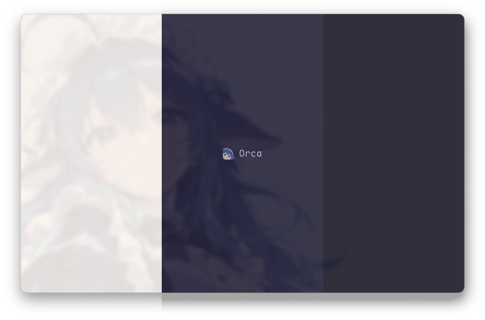
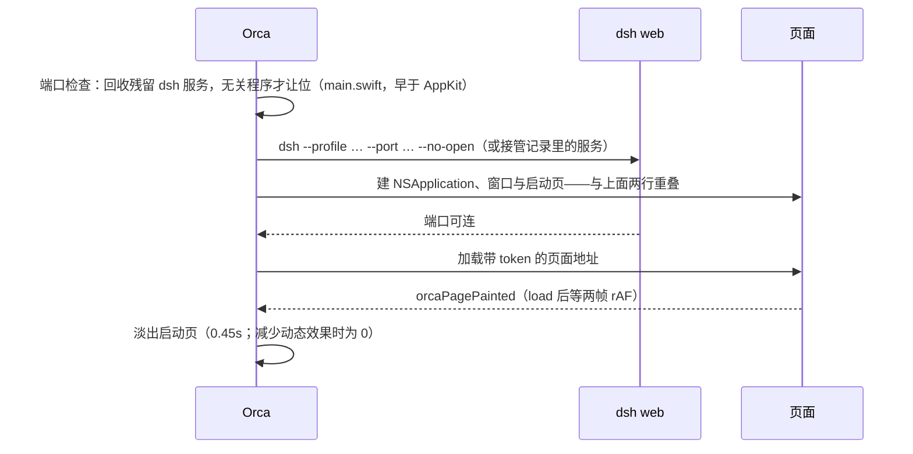

# Orca

DeepSeek Harness 的原生 macOS 外壳。Swift + AppKit + WKWebView，无 Electron。

双击即用：Orca 拉起本地 `dsh web`，把页面装进真正的 Mac 窗口，并让窗口按桌面应用的方式存在——原生红绿灯、系统菜单、可录制的桌面快捷键，以及跟随页面主题的底色。



## 特性

- **原生壳**：窗口、全屏、菜单、缩放和红绿灯由 AppKit 负责，不自绘窗口。
- **启动与刷新**：服务就绪前显示主题启动页；重启服务、刷新页面复用同一表面；交接等页面的首帧事件，不等固定秒数。
- **主题一致**：页面 base 同步到窗口与启动页；`NSApp.appearance` 跟随页面明暗。设置面板与启动页共用底色、角色标和透明标题栏；检查器跟随页面明暗，内部仍由 WebKit 绘制。
- **标题栏三档**：`lightsOnly`（默认）/ `hover` / `hidden`，页面顶部 header 可拖动窗口。
- **应用图标**：六个预设加自选图片；统一合成到 Apple 图标网格，写入 bundle 并重新签名。
- **Web Inspector**：使用 WebKit 自带检查器，独立窗口，不 dock；支持 F12、⌥⌘I 与元素拾取。
- **两套设置**：⌘, 打开页面自己的 DSH 设置；⌥⌘, 打开壳的服务参数面板，互不抢键。
- **界面语言**：壳自己画的部分（菜单、设置面板、启动页、提示）默认中文，可在 ⌥⌘, 里切到 English，切完菜单立即重建；页面语言仍归 DSH 管。

## 构建

要求 macOS 13+ 与 Xcode Command Line Tools。

```sh
./build.sh               # 编译 → 组装 → ad-hoc 签名 → 安装到 /Applications/Orca.app
./build.sh --no-install  # 只产出 build/Orca.app
```

沙箱里编译需要关掉 `swift build` 的 sandbox：

```sh
ORCA_SWIFT_FLAGS=--disable-sandbox ./build.sh
```

可用环境变量：`ORCA_INSTALL_DIR`（默认 `/Applications`）、`ORCA_SIGN_IDENTITY`（默认 `-`）。

`build.sh` 还有两件事，避免重建丢掉用户可见状态：

- **图标**：已安装 bundle 的 `AppIcon.icns` 若与仓库默认图不同，构建时沿用已安装的那一份。
- **签名**：显式使用稳定的 `identifier "com.xu.orca"`，避免 ad-hoc 的 cdhash 变化让 TCC 每次都重新询问权限。

重建后重启：

```sh
osascript -e 'quit app "Orca"'; open -a /Applications/Orca.app
```

## 安装包

```sh
./package.sh            # DMG + PKG
./package.sh --no-pkg   # 只要 DMG
./package.sh --no-dmg   # 只要 PKG
```

产物在 `dist/`：

| 产物 | 用法 |
| --- | --- |
| `Orca-<版本>.dmg` | 拖进 Applications |
| `Orca-<版本>.pkg` | 双击安装，直接写 `/Applications` |
| `SHA256SUMS.txt` | 校验和 |

版本号只写在 `Resources/Info.plist`（`CFBundleShortVersionString` / `CFBundleVersion`），打包与产物命名都从那里取。

本机没有 Developer ID 证书，DMG / PKG 均为 ad-hoc 签名，拷到其他机器首次打开会被 Gatekeeper 拦一次：右键「打开」，或到「系统设置 → 隐私与安全性 → 仍要打开」。要免掉这一步：

```sh
ORCA_SIGN_IDENTITY="Developer ID Application: …" \
ORCA_INSTALLER_IDENTITY="Developer ID Installer: …" ./package.sh
```

当前二进制为 arm64 only。通用包需要完整 Xcode（`swift build --arch arm64 --arch x86_64`），仅装 CommandLineTools 会失败。

## 启动与交接



- **固定端口 4319** 让页面 origin 固定，localStorage 状态才能跨启动保留。端口被占用时先辨认占用者：残留的 `dsh web` 请它退出后继续用 4319；只有被无关程序占用才改用空闲端口。
- **启动页**：磨砂玻璃上加页面主题 base，透明角色标按 app 图标的 squircle 裁形；文字与按钮按底色明暗取色，而不是按系统外观。页面首帧前只接受与已保存主题来源一致的底色，避免启动时闪错主题。
- **交接**：只由页面首帧报告触发（`load` 之后两帧 rAF）。12 秒兜底只留给两种情况：文档永远不结束，和
  刷新静默面收不回来——它不是给「报告迟到」准备的窗口。页面挂载自己的 shell 时主线程会被一整块占住，
  那段忙的时间就是首帧报告的延迟，兜底提前交接只会把还没画的页面交出去。
- **加载预算**：服务链在 `main.swift` 里启动，早于 `NSApplication` 初始化，所以接管探测（本机 0.4–0.5 秒）
  和 `dsh web` 冷启动的 7–9 秒都压在 dyld、AppKit、窗口、启动页这一整段原生前奏下面，而不是排在它前面。
  接管一旦核到端口归属就把地址交给窗口，健康探测降级为后台确认——它答不上来时走的是「接管的服务不再应答
  → 重启一次」那条恢复路径，不再挡在页面前面。菜单之后的热键、外观观察和图标落盘让位给第一次导航：它们等
  服务的第一个答复再跑，页面自己的加载与它们并行。
  日志里 `[launch] … +秒数` 以进程启动为原点，逐段记到窗口、菜单、服务就绪、导航、commit、finish、图标和
  交接（括号写明是页面报告还是兜底），一眼能看出时间花在哪一段。
- **页面自己的启动块**：壳交接之后仍有约 1.5 秒主线程被一整块占住（`domContentLoaded` 到 `load`
  之间没有心跳空档）。逐相位量过：分配模块系统 1ms，18 个 `immediately` 预取**全部**卡在同一时刻
  （1542–1626ms），也就是两个组合包（3.94MB、88 个插件）解析执行完的那一瞬；挂载一个插件只要几毫秒。
  所以这一段不是「插件太多导致的激活慢」，而是「代码必须先到齐」。`deferSecondaryPlugins`（默认关）
  可以把只画设置页/工具面板的插件推到首帧之后再挂载，但实测首帧不动，因此它只是个开关，真正的杠杆在
  dsh 侧：减少启动图里的插件，或把组合包按层拆开，让插件的代码在挂载时才到。
- **静默面**：刷新、重连或 WebContent 崩溃恢复时，新文档 commit 到首帧之间没有东西可画（本机实测
  0.3–1.3 秒），露出来的是窗口材质。这段由静默面接管：材质与启动页同一套——窗口内磨砂加页面主题 base、
  随主题改色——上面只有一枚压暗的标志，没有进度条也没有文字。平铺一整页底色是它的第一版，读起来像页面
  加载失败；磨砂才是「壳在替你把窗口按住」的观感。首帧报告后淡出；静默面只垫在已经撤掉的启动页之下，
  启动页与服务重启仍归服务状态管。
- **静默面的两个入口**：① 新文档 commit；② WebContent 进程退出——视图从那一刻就空了，而重启是延迟的
  （1–2 秒）再加一次导航，所以覆盖必须从终止回调开始，不能等下一次 commit。仅此两处：壳不去「探测」
  页面还能不能画，因为一个只是忙（主线程长任务、唤醒后重绘）的页面答得慢，而把答得慢当成死会白重载一次
  并丢掉滚动位置和输入状态——WebKit 自己会在进程真的没了时报终止。
- **兜底**：`didFail*` 立即撤启动页；导航开始后 12 秒仍无首帧就强行撤（静默面同样受约束，否则一次永不
  提交的重载会把窗口永久按住）。服务失败时显示原因与 Try Again / Service Log。
- **重启服务**（⇧⌘R、改设置或启动页按钮）复用同一张启动页，只显示进度条。

## 服务与端口

上次异常退出留下的服务会被下一次启动复用，端口与登录 cookie 不变。

复用的服务没有子进程可监听，壳每 2 秒检查进程与端口：连续 3 次失联判定死亡，自动重启一次（新 token，页面按新地址重载），再死就回到启动页。

因此，改端口偏好不会立刻生效：只要旧服务还活着就会被复用，需要重启服务或等旧服务退出。

## 窗口与主题

红绿灯默认常显，没有可见标题栏；页面自带顶部标题条，原生灯下移 9pt 与图标行对齐。

| 档位 | 表现 |
| --- | --- |
| `lightsOnly`（默认） | 真灯常显，页面全幅 |
| `hover` | 隐藏，指针进入顶部 28pt 才淡入 |
| `hidden` | 完全隐藏 |

枚举里另有 `shown` 占位：它对应「标准标题栏」，但壳不画那一档——页面自己的标题条就是标题行，再套一层系统标题栏只会多一条空白。所以它的渲染与 `lightsOnly` 完全一致，也不对外提供，只保留名字给旧偏好和插件侧的对应关系。

页面 header 是拖拽区（高度按页面实测上报，兜底 40px），点按先交给网页。⌘W 关闭窗口但不退出应用；⌘Q 退出并停止服务，设置里开启「退出后保留服务」时除外。

主题同步分两层：

- 页面把 base 通过 `orcaPalette` 交给壳，壳铺在窗口、启动页和设置面板上；启动页与设置面板按 base 明暗设置自己的 appearance。
- 页面把 `data-ds-theme-source` 交给壳，壳同步 `NSApp.appearance`；主窗口、菜单、对话框与检查器窗口跟随页面深/浅。

这两层都要页面在跑，而变体存在页面的 `localStorage` 里——在别的浏览器换了变体、Orca 没开过，下次冷启动第一帧仍会铺旧底色。所以再加一道路径：主题插件把当前变体的两个底色写进 `~/Library/Application Support/Orca/theme.json`，启动时优先读它（按 `themeSource` 取 light / dark 一侧），文件不在才用页面上次报的 base。文件由插件维护，主题关闭或被卸载时删掉。

Orca 原生设置面板与启动页共用同一套视觉：角色标 + Orca / DeepSeek Harness 标头、主题底色、隐藏透明标题栏、24pt 内容边距。刷新页的磨砂玻璃只用于启动/重启过渡，不复制到常驻页面。

主窗口最底下铺一层 `NSVisualEffectView`（`.underWindowBackground` + `.behindWindow`），也就是页面透明处看到的系统毛玻璃。它由 `dsh-patch` 的「补丁 → 背景」里「原生毛玻璃」一行控制，值存在窗口自己的偏好里（`glassEnabled`，默认开），页面经 `__ORCA_GLASS__` 桥读写：开 = 窗口透明、材质在位，调低界面不透明度就透出模糊的桌面；关 = 材质隐藏、窗口改刷页面 base，同一处透明看到的就是平的底色。两种状态都不动 `isOpaque`，只换窗口画的颜色。

## 快捷键

| 操作 | 快捷键 |
| --- | --- |
| 刷新页面 | ⌘R |
| 从服务器重新加载 | ⌥⌘R |
| 实际大小 / 放大 / 缩小 | ⌘0 / ⌘+ / ⌘- |
| 全屏 | ⌃⌘F |
| 重启本地服务 | ⇧⌘R |
| 在浏览器打开 | ⇧⌘O |
| 检查器 | F12 或 ⌥⌘I |
| 元素拾取 | ⌘⇧C |
| Orca 设置 | ⌥⌘, |
| 关闭窗口（应用保留） | ⌘W |
| 最小化 | ⌘M |
| 退出 | ⌘Q |

`File → Copy Access Link` 复制带 token 的访问地址。⌘, 不由 Orca 占用，交给页面的 DSH 设置。

页面以 `<html data-platform="darwin">` 启动，DSH 快捷键服务因此按桌面运行时工作；键位覆盖存在 `~/Library/Application Support/Orca/keybindings.json`。原生菜单仍会先截获 ⌘R、⌘W、⌘Q 等组合。Electron 默认菜单的对照表保留在 `ElectronShortcuts.swift`，当前仅作决策记录，没有消费者。

## 设置

| 面板 | 快捷键 | 管什么 |
| --- | --- | --- |
| DSH 设置 | ⌘, | 主题、插件、账户、快捷键、图标 |
| Orca 设置 | ⌥⌘, | 壳自己的服务参数与界面语言 |

Orca 设置的字段（面板跟随界面语言，下面是中文默认；切到 English 后对应 Port / Profile / dsh command 等）：

| 项 | 默认 | 说明 |
| --- | --- | --- |
| 端口 | `4319` | `0` 表示自动挑空闲端口 |
| 配置 | `web` | `dsh` 启动的 profile |
| dsh 命令 | `dsh` | PATH 名或绝对路径；GUI 进程会自动补常见 PATH 目录 |
| 退出 Orca 后保留本地服务 | 关 | 退出后保留服务 |
| 关闭输入辅助 | 开 | 关掉页面文本框的自动纠错、补全、拼写检查与首字母大写 |
| 界面语言 | 中文 | 中文 / English，只影响壳自己画的部分 |

改 Port / Profile / command 会重启服务。各插件写在磁盘上的配置不受影响；切端口后页面 origin 的 localStorage 目前从空存储开始（迁移的抓取端尚未接入）。

## 应用图标

设置页的图标行给出六个预设，经 `orcaAppIcon` 桥交给壳合成：

| 预设 | 来源 |
| --- | --- |
| `orca` | 初始图标，固定 |
| `dawn` / `main` / `moon` | 三套主题变体，可切 不跟随 / 随主题 / 随系统 |
| `template` | `OrcaOutline.svg` + 自选底色，可切 不跟随 / 随主题 / 随系统 |
| `custom` | 用户自选图片，固定 |

所有素材统一经 `IconProcessor` 合成到 1024 画布（824 主体、内缩 100）并裁成连续曲率 squircle；`IcnsWriter` 直接写 PNG-backed `.icns`，不依赖 `iconutil`。

选中结果写入已安装 bundle 的 `Contents/Resources/AppIcon.icns`，并更新运行中的 Dock tile。写 bundle 后会重新 ad-hoc 签名（`AppBundleSeal`），再推进 bundle 修改时间让 LaunchServices / IconServices 丢弃旧缓存。`build.sh` 装完后不留汇编目录里的同名 `.app`：同一 bundle id 的第二份会让 Finder / Spotlight / Dock 抓到构建时的那张图标。

Orca 没运行时由 `orca-icon-sync`（per-user LaunchAgent）接手。它不做任何合成：Orca 每次落图标时把两套外观的成品写进 `~/Library/Application Support/Orca/AppIconVariants`（`light.icns` / `dark.icns` 加 `manifest.json`，记录 preset / mode / themeSource 与各自 signature），helper 只按当前系统外观挑文件、比对字节、写入并重新签名。manifest 与磁盘上的设置对不上时视为过期，helper 不动 bundle——宁可等下次开 Orca，也不装回上一次的选择。

Dock 磁贴本身不去追。用 `NSWorkspace.icon(forFile:)` 实测（它和 Dock / Finder 吃同一份图标缓存）：IconServices 只凭图标文件变化就会换，但 Dock 画的是自己那份快照，只有重启 Dock 才会重读，而重启会让整条 Dock 闪一下——比一个落后一次启动的磁贴更挠人，所以不做。

只有能真正变化的组合才会产出两份图：`none`、页面 pin 住 light/dark 的 `theme`、以及页面画的明暗和 Mac 相反（见下一段）的 `theme`，都只写一份 `steady.icns`，manifest 里两个外观都指向它。`theme` 模式下「正在画的那一侧」一律取页面实时上报的 base；「另一套外观」取页面在该侧最近一次画过的 base（`splashBaseColorLight` / `splashBaseColorDark`），页面从没在那个外观下渲染过才回落到图标自己的 `#faf4ed` / `#191724`。当页面画的明暗和 Mac 相反（主题钉死在一层，例如深色 Mac 上的 dawn），说明它下一次翻转也不会重画，于是同一层回答两套外观；`resolvedVariant` 对主题预设用同一条判断。

agent 常驻（`KeepAlive`），自己听 `AppleInterfaceThemeChangedNotification` 和 `cordis.patch.yml` 的写入，另有 5 分钟兜底轮询。不再用 `WatchPaths` 盯 cfprefs plist：那几个文件的落盘时机由 cfprefsd 决定，靠不住。

agent 的安装只在 `build.sh` 里做：bundle 里的 plist 模板（`Contents/Resources/com.xu.orca.icon-sync.plist`，带 `__INSTALL_DIR__` / `__HOME__` 占位）写进 `~/Library/LaunchAgents`，再 `bootout` + `bootstrap` 一次。所以手动拷进 `/Applications` 的 app 要重跑一次 `build.sh` 才会自愈。

切换时旧图标的处理：

- 内置预设的源 `.icns` 从不覆盖；旧选择随时可由源素材重建。
- 当前生成的 `AppIcon.icns` 直接被覆盖，不归档、不留历史。
- 自选图片保存在 `~/Library/Application Support/Orca/app-icon.png`；切到其他预设时保留，只有再选一张新图才覆盖。
- `reset` 回到 Orca 图标，不删除自选图。
- `build.sh` 重建时沿用已安装的 `AppIcon.icns`，所以最后一次选择能跨重编译保留。

## 开发者工具

F12 或 ⌥⌘I 打开 WebKit 自带 Web Inspector（Elements / Console / Sources / Network / Timelines / Storage），只在独立窗口打开，从不 dock。壳在进程内把 `_WKInspector` 的 `attach` 换成 `detach`，并每秒兜底一次，连右键「检查元素」也只会落在独立窗口。

元素拾取：⌘⇧C 打开检查器并进入拾取，页面里悬停高亮、点击选中；再按 ⌘⇧C 或 Esc 停止。页面窗口里的 Esc 先停拾取再关检查器，检查器窗口里的 Esc 只停拾取。

检查器依赖 `get-task-allow`（`Resources/Orca.entitlements`，构建时签名带上）；缺这个 entitlement 时 `show` 是静默空操作，3 秒后壳会弹 sheet 说明。检查器窗口只跟随页面明暗，标题栏与内部布局保持 WebKit 原样。早期自研 inspector 已删除，需要时从 git 历史取回。

## 数据与日志

| 路径 | 内容 |
| --- | --- |
| `~/Library/Logs/Orca/service.log` | `dsh web` 自己写入的 stdout/stderr，Orca 退出后仍继续写；含访问 URL 与 token，分享前脱敏 |
| `~/Library/Logs/Orca/web.log` | 页面 console.error 与未捕获异常 |
| `~/Library/Application Support/Orca/session.json` | 服务 pid + 访问 URL（0600），仅用于下次启动重连 |
| `~/.dsh/state/orca-service.json` | 常驻服务的可发现端点：pid、访问 URL、token 签发时间（0600） |
| `~/Library/Application Support/Orca/keybindings.json` | DSH 桌面快捷键覆盖 |
| `~/Library/Application Support/Orca/app-icon.png` | 自选应用图标 |

终端取用已运行的服务时读 `orca-service.json` 的 `url` 字段即可，不必再启动第二个 `dsh web` 抢同一个端口。重启本地服务会签发新 token，并同步更新两个记录。

## 源码导航

| 想改什么 | 看哪里 |
| --- | --- |
| 窗口、启动页、交接、主题 | `MainWindowController.swift`、`SplashView.swift`、`WindowChrome.swift` |
| 页面、注入脚本、原生桥 | `WebPageController.swift`、`WebPageScripts*.swift`、`WebPageBridge*.swift` |
| 服务、端口、进程复用 | `ServiceController.swift`、`PortOwner.swift`、`PortProbe.swift`、`ServiceSession.swift` |
| 检查器 | `InspectorController.swift` |
| 图标、合成、重签名 | `AppIcon.swift`、`IconProcessor.swift`、`IcnsWriter.swift`、`AppIconInstaller.swift`、`AppBundleSeal.swift` |
| 设置、菜单、快捷键 | `SettingsWindowController.swift`、`Preferences.swift`、`MainMenu.swift`、`GlobalHotkeys.swift` |

```text
Sources/Orca/         Swift 源码
Resources/            Info.plist、图标素材、entitlements
docs/screenshot.png   README 截图
build.sh              编译 + 组装 + 安装
package.sh            DMG / PKG（dist/ + SHA-256）
```

## 整理记录

`docs/tidy-ledger.md` 是这仓库和自养插件的整理台账：写清了哪些项已经查过且有结论（不用再查第二遍）、哪些是待办、哪些要人定口径。动整理之前先读它的 §3。

## 设计取舍

- **检查器用 WebKit 自己的**：私有 `_WKInspector` 就是 Safari 那一个，自己重写 Elements/Network 只会更弱；代价是依赖私有 API 和 `get-task-allow`。
- **按桌面运行时跑**：`data-platform="darwin"` 加临时 `dshDesktop` 键盘桥，让 DSH 快捷键能录 ⌘C、⌘K 这类网页模式会拒绝的键；桥在 shortcuts 服务捕获后立即撤下。
- **保留原生 `.titled + .fullSizeContentView`**：只调灯的显隐和内容底色，阴影、圆角、缩放、全屏仍归 AppKit。
- **页面自己画背景**：web view 透明，窗口与启动页铺主题 base，避免默认窗口灰在首帧或淡出时露出。
- **origin 迁移不伪造数据**：`WebPageStorage` 按端口守卫、一次性会话标记回放快照，不覆盖迁移后新写的数据；抓取端未接入时宁可空存储，也不假装成功。
- **图标写 bundle 后必须重签**：`AppIcon.icns` 是 sealed resource；`AppBundleSeal` 合并写入、后台串行、退出前 flush，保证签名与磁盘一致。
- **空白弹窗交回真 web view**：`window.open('about:blank')` 用页面配置建窗口（同 cookie 存储）但清空 `userContentController`，桥不跑在第三方页面上。

## 已知限制

- 检查器来自 WebKit 私有接口，不保证跨 macOS 大版本可用；失效时表现为 F12 无反应，3 秒后弹 sheet 说明。
- `get-task-allow` 允许同用户进程附加调试器；这是本地开发壳的取舍，发布给不特定用户时请自行决定是否保留。
- 检查器只挂在主窗口的 web view 上，页面自己开的登录/授权弹窗不在覆盖范围。
- Orca 自带一个 `dsh web` 实例；同时在终端跑 `dsh web` 会共享 `~/.dsh` 存储，可能互相干扰，日常建议只保留 Orca。
- `dsh` 以 Orca 的身份访问文件；首次打开工作区时 macOS 会请求「文稿」权限，重建后签名变化可能再问一次，可在「系统设置 → 隐私与安全性 → 文件与文件夹」调整。
- 页面切换端口后 localStorage 目前不会迁移（抓取端未接入），新 origin 从空存储开始。
- 当前只构建 arm64；通用包需要完整 Xcode。
- ad-hoc 签名、未公证；本机构建不带隔离属性，网络下载的包首次打开需 Gatekeeper 放行。
